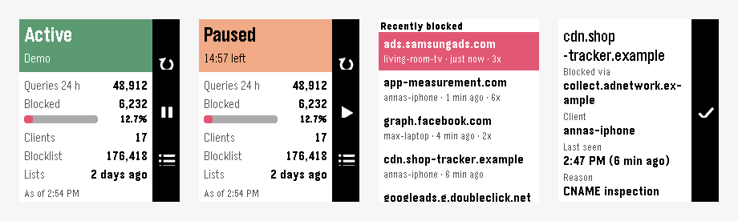

# Pi-hole für Pebble

Den Status deines Pi-hole sehen, das Blockieren per Knopfdruck pausieren und zuletzt
blockierte Domains freigeben – direkt auf deiner Pebble-Uhr.



*Screenshots aus dem Emulator mit erfundenen Beispieldaten.*

[English version](README.md) · [Änderungen](CHANGELOG.md) · [Mitmachen](CONTRIBUTING.md)

Wenn dir die App gefällt, freue ich mich über einen [Kaffee](https://buymeacoffee.com/michaelrunge) ☕ –
kostenlos und Open Source bleibt sie so oder so.

## Funktionen

- **Status** – aktiv oder pausiert (mit Countdown), Anfragen und Blockierte der letzten
  24 Stunden, aktive Geräte, Größe der Blockliste und wann die Listen zuletzt aktualisiert wurden
- **Pausieren** – 30 Sekunden, 5 oder 15 Minuten, 1 Stunde oder unbegrenzt, und jederzeit wieder
  aktivieren. SELECT lang drücken pausiert für deine Standarddauer.
- **Vibration am Ende der Pause** – auch wenn die App geschlossen ist
- **Schnellstart** – Pi-hole auf eine Schnellstart-Taste legen: lang drücken pausiert bzw.
  aktiviert sofort
- **Zuletzt blockiert** – die letzten blockierten Domains mit Gerät, Zeit und Grund.
  Eine Domain mit einem Knopfdruck freigeben (und wieder zurücknehmen). Bei CNAME-Sperren
  wird das blockierte Ziel freigegeben.
- **AppGlance** – in der App-Liste steht „Aktiv · 12,7 % blockiert“ oder „Pausiert bis 14:35“
- **Touch** auf der Pebble Time 2: Aktionsleiste oder Statusbalken antippen
- **Deutsch und Englisch**
- **Privat** – die App spricht nur mit *deinem* Pi-hole. Sonst nichts, kein Tracking.

## Voraussetzungen

- Eine Pebble Time 2
- Die Pebble-App auf iPhone oder Android
- **Pi-hole 6** (die neue REST-API), den das Handy erreicht

## Installation

1. `pihole-pebble.pbw` aus dem [neuesten Release](../../releases/latest) laden und mit der
   Pebble-App öffnen – **oder** selbst bauen (siehe unten).
2. In der Pebble-App **Pi-hole → Einstellungen** öffnen und eintragen:
   - die Adresse deines Pi-hole, z. B. `http://192.168.1.2` (mit `:Port`, falls nicht 80;
     `/admin` darf dabei sein)
   - ein **App-Passwort** (empfohlen): Pi-hole → *Settings → Web interface / API* →
     auf *Expert* stellen → *Configure app password* → kopieren und mit *Enable new app password*
     bestätigen. Dein normales Passwort geht auch, aber nicht mit Zwei-Faktor-Anmeldung.
     Leer lassen, wenn dein Pi-hole kein Passwort hat.

Nur neugierig? `demo` als Adresse eintragen und mit Beispieldaten ausprobieren.

**HTTPS:** Das eingebaute HTTPS von Pi-hole nutzt ein selbstsigniertes Zertifikat, das die
Pebble-App nicht akzeptiert. Im Heimnetz also `http://` verwenden oder einen Reverse Proxy mit
echtem Zertifikat.

## Bedienung

| Wo | Taste | Aktion |
|---|---|---|
| Status | UP | neu laden |
| | SELECT | Pausen-Menü (bzw. Menü zum Aktivieren, wenn pausiert) |
| | SELECT lang | Standardpause / wieder aktivieren |
| | DOWN | zuletzt blockiert |
| Zuletzt blockiert | SELECT | Details |
| Details | SELECT | freigeben / Freigabe zurücknehmen |
| | UP / DOWN | scrollen |

## Selbst bauen

```bash
# Linux / macOS / Windows (WSL) – siehe https://developer.repebble.com/sdk/
uv tool install pebble-tool --python 3.13
pebble sdk install latest

pebble build
pebble install --emulator emery     # Emulator
pebble install --cloudpebble        # Uhr (Dev Connect in der Pebble-App einschalten)
```

Im Emulator öffnest du die Einstellungen mit `pebble emu-app-config`.

Aufbau des Projekts und technische Details: siehe [README.md](README.md#how-it-works).

**Sicherheitshinweis:** Ein App-Passwort hat volle Admin-Rechte auf deinem Pi-hole – Pi-hole
kennt keine Nur-Lese-Passwörter. Es wird nur in der Pebble-App auf deinem Handy gespeichert.

## Wie die App entstanden ist

Die App ist mit viel Unterstützung von Claude (KI) entstanden und im Emulator sowie auf meiner
eigenen Pebble Time 2 getestet. Fehlermeldungen und Pull Requests sind willkommen.

## Lizenz

[MIT](LICENSE) © 2026 Michael Runge. Fremder Code: siehe [THIRD_PARTY_NOTICES.md](THIRD_PARTY_NOTICES.md).

Pi-hole® ist eine eingetragene Marke von Pi-hole LLC. Dieses Projekt steht in keiner Verbindung
zu Pi-hole LLC und wird von ihr nicht unterstützt.
